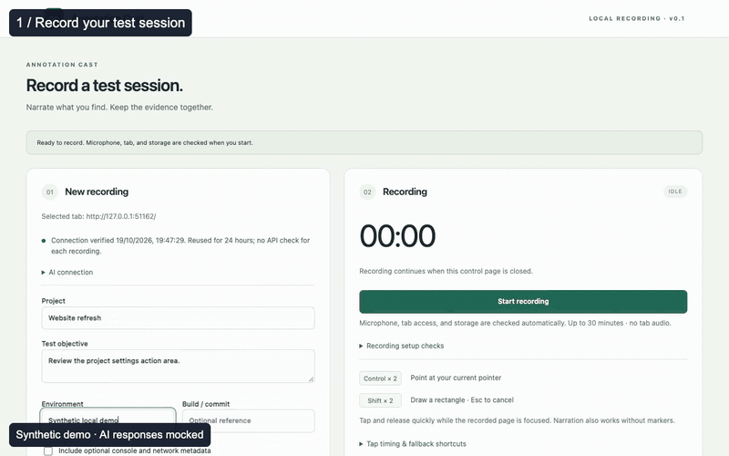

<p align="center">
  
</p>

<h1 align="center">Annotation Cast</h1>

<p align="center"><strong>Early preview – actively developed</strong></p>

<p align="center">
  Turn narrated web app tests into illustrated issue reports for coding agents.
</p>

<p align="center">
  <a href="https://github.com/mulkatz/annotation-cast/actions/workflows/verify.yml"></a>
  <a href="LICENSE"></a>
</p>

<p align="center">
  <a href="#quick-start">Quick start</a> ·
  <a href="docs/user-guide.md">User guide</a> ·
  <a href="docs/testing.md">Testing</a> ·
  <a href="CONCEPT.md">Concept</a>
</p>

<p align="center">
  <a href="docs/assets/demo.mp4"></a>
</p>

<p align="center">
  <em>Silent walkthrough. Synthetic app and microphone; AI responses mocked.</em><br />
  <a href="docs/assets/demo.mp4">Watch the video</a> ·
  <a href="docs/assets/demo-poster.png">Still preview</a>
</p>

## Why Annotation Cast?

- **Describe what you see.** Record a selected tab and your microphone, with optional markers.
- **Keep the original context.** Points freeze page details; rectangles identify a region.
- **Review the evidence together.** Findings link narration, screenshots, timestamps, and context.
- **Resume incomplete analysis.** Saved checkpoints and visible failure details support retries.
- **Take the report with you.** Export a ZIP for a person or coding agent. No custom backend.

## Quick start

Requires **Node.js 22.12+**, **Chrome/Chromium 120+**, and a personal **OpenRouter key**.

```sh
git clone https://github.com/mulkatz/annotation-cast.git
cd annotation-cast
npm ci
npm run verify
```

1. Open `chrome://extensions`, enable **Developer mode**, and select **Load unpacked → dist**.
2. Pin **Annotation Cast**, open the web app you want to test, and click the extension toolbar button.
3. Save your OpenRouter key and select **Verify connection**. Sample API requests may incur charges.
   A verified connection is reused for up to 24 hours; microphone, tab, and storage are checked
   before each recording.
4. Select **Start recording**, speak during the microphone check, then return to the app and narrate.
5. Reopen controls from the toolbar and select **Stop recording**. Review the transfer overview,
   select **Start analysis**, inspect the findings, then **Download ZIP**.

Only the selected tab and microphone are recorded; tab audio is excluded. Closing controls
keeps capture running. Sessions stop automatically after 30 minutes. Rebuild and reload
the unpacked extension after code changes.

[Full operating guide →](docs/user-guide.md)

## Mark what matters

| Action                                    | Control                   |
| ----------------------------------------- | ------------------------- |
| Freeze a point and its page context       | Double Control            |
| Draw a rectangle without creating a point | Double Shift, then drag   |
| Cancel rectangle drawing                  | Escape                    |
| Fallback point / rectangle                | Alt+Shift+P / Alt+Shift+R |

Gestures work in the recorded page with site access. You can also narrate without a marker.
[Gesture details and permissions →](docs/user-guide.md#recording-and-evidence)

## An illustrated report, with its sources

Open **`report.md`** in the exported ZIP. It brings together findings, source statements,
marker context, images, gaps, and the transcript. Model-cited images and automatically
selected temporal candidates are labeled separately; proximity does not establish support.

The ZIP also includes `recording.webm`, `issues.json`, `transcript.json`, `events.json`,
`session.json`, and `screenshots/`, with relative references for people and agents.
[Export format and recovery →](docs/user-guide.md#processing-recovery-and-zip-format)

## Privacy and preview limits

- Capture stays local until you start analysis; audio, selected images, and context then go
  directly to OpenRouter and its routed providers. API verification and analysis may cost money.
- Supported text secrets are sanitized locally. **Audio, images, and video are not automatically
  anonymized.** Keys stay in extension storage and are excluded from exports.
- AI findings are **unreviewed**. Check their sources; ambiguous or missing evidence remains possible.
- Export requires successful analysis. This preview has no raw-export mode, results editor, or
  automatic code fixing. Crash recovery is best effort; interrupted media may be unplayable.

[Provider and privacy details →](docs/user-guide.md#providers-and-privacy) ·
[Validation evidence and limitations →](docs/testing.md)

## Development

`npm run verify` checks formatting, lint, strict types, synthetic tests, build, and secrets.
Default verification and CI block or mock providers; paid live checks require explicit opt-in.

[Commands and acceptance tests](docs/testing.md) ·
[Architecture decisions](docs/adr/) ·
[Continuation prompt](docs/continuation-prompt.md)

Licensed under the [MIT License](LICENSE).
